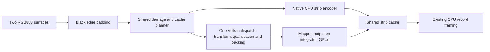

## GPU encoder prototype

The **vino-gpu** CLI is an offline userspace implementation of the Ella 8-bit
encoder on Vulkan compute. It answers whether this implementation is correct
and whether moving the complete codec onto the Radeon 780M improves throughput
and combined CPU/GPU energy enough to justify live integration.

The [live official-driver comparison](gpu-official-comparison.md) records
CPU use of the installed DisplayLink service with the same source images.

See [initial measured results](gpu-encoder-results.md) and the
[shared-memory follow-up](gpu-encoder-followup.md) for the performance evidence, and
[Windows shader research](gpu-windows-shaders.md) for the binary observations.
The current [fused encoder and framing changes](gpu-deep-optimization.md) remove
intermediate transfers and temporary CPU copies.
The optional [direct EVDI capture path](gpu-direct-capture.md) additionally removes
the userspace RGB snapshot and desktop input upload.

### Scope

The target is an EllaDock/DL-3x00 profile with 64×16 strips and two 1920×1080
RGB888 surfaces, padded with black to 1920×1088. The local dock identifies as
USB `17e9:4307`, EllaDock, firmware `12.3.37` in its cached identity descriptor.
The product ID alone does not select the codec family.

This program generates synthetic input and produces encoded strips and framed
records in memory. It does not claim a USB interface, send transfers, load a
kernel module, replace DisplayLinkManager, or flash firmware. Successful offline
validation is insufficient evidence to connect this backend to a live dock.

HDR, Ridge, Navarro, GPU framebuffer imports, adaptive quality, asynchronous
pipeline overlap and compositor integration are outside this prototype. Each
head completes synchronously before the next one starts.

### Build

Commands below run from the repository root, **~/Projects/Vino** on the original
machine. Rustup is shared; **rust-toolchain.toml** selects Rust `1.99.1` for this
repository. No wrapper or environment activation is required.

The encoder requires Cargo, a C toolchain for existing dependencies, `glslc`,
the Vulkan loader and a hardware Vulkan 1.2 driver. Verification also requires
`VK_LAYER_KHRONOS_validation`. On Ubuntu these are supplied by the usual build
tools, **glslc**, **libvulkan1**, **mesa-vulkan-drivers** and
**vulkan-validationlayers** packages. Python 3 is used for the independent
decoder. **spirv-tools** is useful for inspecting the generated SPIR-V.

```bash
RUSTFLAGS='-C target-cpu=native' cargo build \
    --manifest-path revdi/Cargo.toml -p vino-gpu-encoder --release --locked
revdi/target/release/vino-gpu devices
```

The prototype is an explicit workspace package; default workspace builds keep
the original members and do not require the GLSL compiler. Debug builds cannot
run the benchmark.

The device must support five compute storage buffers, 64-lane workgroups and
at least 6,988 bytes of workgroup shared memory.
The default GPU must be an AMD Radeon 780M. The global `--device INDEX` option
selects another listed hardware GPU explicitly. Software and virtual Vulkan
devices are rejected. Energy comparisons currently require a matching AMD
integrated GPU with readable `power1_average`; a discrete GPU's own power
counter would omit CPU consumption.

The native build flag enables the compiler to use the local CPU's instruction
set for the reference codec. The CPU backend also sweeps worker counts. This is
the existing Vino userspace codec compiled for this processor, not a claim to
have implemented the fastest possible CPU encoder or benchmarked the official
DisplayLink driver.

### Data path



The `StripEncoder` trait returns one complete strip body per requested
coordinate, in the supplied order. `HeadScanout::encode_with` calls a backend
only for cache misses. Cached retransmissions retain the existing presentation
and debt rules. No GPU command is submitted when the surface has settled or
only cached bodies are needed. A failed or partial batch leaves the strip cache
unchanged; the caller can retry with another backend.

The original `HeadScanout::encode` remains a CPU entry point. The vendored kernel
codec is unchanged and supplies the reference bytes and framing.

The GPU backend allocates reusable storage for the padded input, coordinates,
bounded output slots, length/status metadata and optional cursor bitmap. Coefficients and significant
indices stay within one workgroup's shared memory:

- The transform shader uses one 64-lane workgroup per strip; each lane handles a
  4×4 quadrant across all three colour planes, sharing pixel loads and keeping
  the first two Haar levels in registers, with integer arithmetic matching the CPU
- Shared memory stores a colour triplet in one 32-bit word: signed 11-bit
  chroma fields and a 10-bit luma field, signed for AC and unsigned for DC
- The RGB888 quantisation bounds are ±1020 for chroma AC, ±510 for luma AC,
  ±255 for chroma DC and 0–1020 for luma DC; this layout does not support HDR
- Packing reads the same transposed shared array, with a 17-word stride, directly
  after the transform. There is no intermediate device buffer or second dispatch
- Parallel scans compute stream offsets. The workgroup writes the header and
  encodes the significance, DC and AC streams
- Each stream accumulates bits in a register and writes complete interior words
  directly, using atomic OR only at shared boundary words
- Only words within the actual encoded length are cleared before stream writes
- Integrated GPUs write directly into host-visible coherent output memory,
  preferring CPU-cached storage. Discrete GPUs retain a device-local output and
  staging copy
- Sparse updates upload only requested strip rows, coalescing adjacent requests;
  updates covering at least one quarter of the surface retain one contiguous copy
- Direct native capture binds the leased capture allocation instead of uploading
  desktop pixels and blends an optional cursor before the colour transform
- Explicit memory barriers and a completion fence precede CPU reads
- An 8192-byte slot bounds each strip; the shader checks the computed output
  length before writing any stream and reports overflow

The 8192-byte bound covers 48 planes × 63 AC values × at most 20 bits, 48 DC
values × at most 20 bits, 16 significance units × at most 39 bits, the 16-byte
header and even-byte region padding. The total remains below the slot size.
The verification command forces the real overflow branch with a smaller limit
and checks recovery afterward.

GPU timestamps report the combined shader in `fused_ms`; legacy `transform_ms`
and `pack_ms` fields remain zero. Host timers measure upload, submission plus
wait, and readback. These diagnostic totals overlap: GPU kernel
time is inside submission plus wait, and must not be added to it. The wall-clock
frame-pair time is the performance metric. Timestamp diagnostics are absent on
queues without timestamp support.

### Testing

1. Build the native release binary with the command above and run the unit tests, then **verify** that the existing Chimera suite and prototype tests pass:
    ```bash
    RUSTFLAGS='-C target-cpu=native' cargo test \
        --manifest-path revdi/Cargo.toml \
        -p vino-chimera -p vino-gpu-encoder --release --locked
    ```
2. Run the complete GPU comparison and **verify** that the report contains `"passed": true` and `"validation_errors": 0`:
    ```bash
    revdi/target/release/vino-gpu verify --output gpu-artifacts/verification
    ```
3. Decode the exported strips with the independent Ella grammar decoder and **verify** that all 72 strips pass:
    ```bash
    python3 tools/gpu/check-ella-strips.py gpu-artifacts/verification/ella-strips.hex
    ```
4. Run the binary extraction bounds checks and **verify** that all tests pass:
    ```bash
    python3 tools/gpu/test-extraction.py
    python3 tools/gpu/test-host-trace.py
    ```

Full verification compares 16,610 strip bodies across 223 surfaces, plus 64
framed head outputs. It includes black, white, primaries, gradients, checkerboard,
noise, text-like scrolling, moving patterns, unaligned dimensions with black
padding, 128 random seeds, empty batches, invalid coordinates, unsupported HDR,
overflow recovery, cached debt and settled idle behavior. It also covers 54
coefficient-boundary surfaces and sparse uploads across changed dimensions,
reordered coordinates and duplicate strips. `verify --quick`
uses smaller surfaces and fewer seeds for development.

The independent decoder checks the Ella bitstream grammar, region boundaries
and zero padding; it does not reconstruct or compare displayed pixels. Exact
agreement with the existing CPU codec is the pixel-encoding oracle. Actual
dock acceptance remains a separate future check.

### Measurements

For the two dense workloads:

```bash
revdi/target/release/vino-gpu bench \
    --cases motion,noise --sweep-seconds 5 \
    --output gpu-artifacts/acceptance
```

For a shorter check of idle, small damage and scrolling behavior:

```bash
revdi/target/release/vino-gpu bench \
    --cases idle,small,scroll --seconds 5 --warmup 1 --pairs 1 \
    --sweep-seconds 1 --output gpu-artifacts/desktop-diagnostics
```

The default benchmark cases include all five workloads; the default dense
acceptance parameters are five paired repetitions, a 15-second warmup before
each measurement and 60 seconds per paced energy measurement. The saturation
measurements and worker sweeps use `--sweep-seconds`, defaulting to 2 seconds.
The recorded acceptance command uses 5 seconds. Running both dense cases takes
roughly 35 minutes; running all five with full settings takes longer.

Each case precomputes the same 16-frame sequence for two heads. Input generation,
pipeline creation and initial buffer allocation are outside steady-state timing.
Padding, damage detection, cache processing, transfer, GPU synchronisation,
readback, output allocation and CPU record framing are inside it. Both backends
use the same cache, retransmission rules and frame sequence. Warmup ends at a
sequence boundary before measurement begins.

CPU throughput sweeps 1, 2, 4, 8, … available workers and selects the fastest
observed configuration. Energy uses a separate worker sweep at a common rate,
chosen as 85% of the slower measured CPU/GPU capacity, capped at 60 frame pairs/s.
The lowest-energy CPU configuration that sustains that rate is selected. It is
therefore possible for throughput and energy to use different CPU worker counts.

Each energy pair completes identical frame sequences, strip counts and framed
byte counts. The program rejects unequal work. Both backends must remain within
2% of the chosen rate for an energy win to count. If sustained capacity drops,
the result cannot establish an equal-rate energy win. CPU-first and GPU-first
order alternate between pairs.

The AMD APU's `power1_average` is sampled at approximately 100 ms intervals and
integrated over the measured window. It includes CPU and GPU/SoC power, according
to the [kernel amdgpu documentation](https://docs.kernel.org/gpu/amdgpu/thermal.html).
It excludes the rest of the laptop and dock. Package temperature is recorded as
context, not as proof that the laptop runs cooler. Desktop activity, the existing
display stack, clock changes and other processes remain possible confounders.
No clock, governor or power-limit setting is changed by the program.

The JSON report contains device identifiers, kernel, CPU model/features, build
flags, benchmark options, worker sweeps, per-run latency percentiles, process
CPU time, frame/strip/byte counts, stage timings, energy and raw power samples.
Per-case pair checkpoints are written as each pair finishes.

A deterministic paired bootstrap of geometric mean ratios supplies 95%
confidence intervals after at least five pairs. Fewer repetitions are labelled
exploratory. The go decision requires both motion and noise to satisfy:

- Lower bound of GPU/CPU throughput ratio at least 2
- Upper bound of GPU/CPU joules-per-frame-pair ratio below 1 at a matched rate
- At least 60 frame pairs/s in every GPU saturation window
- Worst GPU p99 processing time across saturation and paced windows at most 16.7 ms

Shorter warmups/windows, explicit CPU worker counts, non-native builds and
different dimensions cannot produce an acceptance verdict. Missing power
telemetry prevents an energy win. These gates govern this prototype on the
measured system, not the general feasibility of GPU encoding. The 60 Hz measure
is offline encoding capacity, not observed monitor refresh or compositor latency.

All proprietary inputs, disassembly, build tools and raw machine-specific reports
remain under the ignored **gpu-artifacts/** directory. The reviewed conclusions
belong in the documentation; no Windows binary is required in Git.
